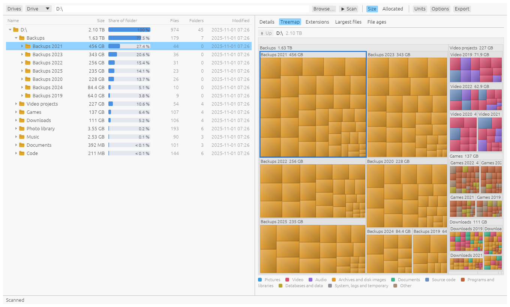
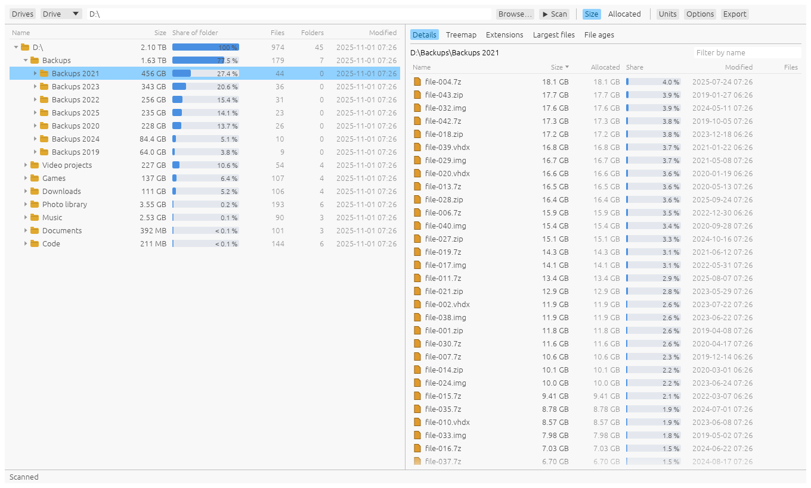
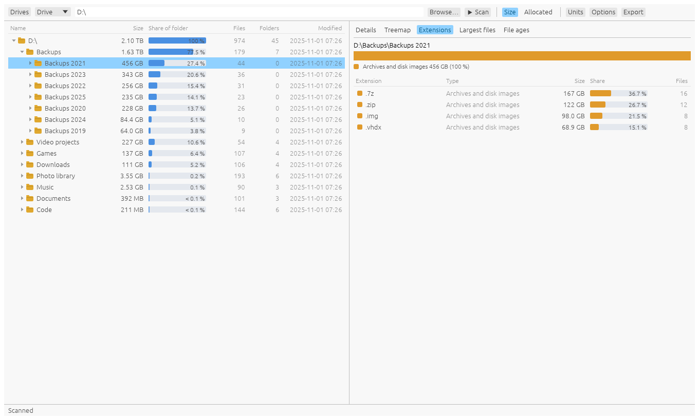
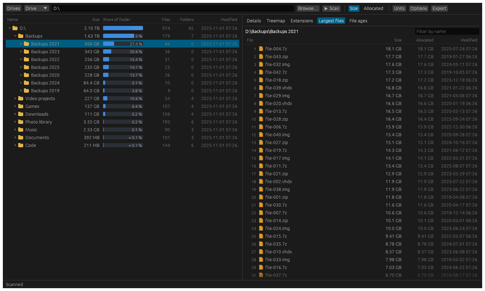

# WhatSpace


**See what is taking up space on your disks. An open-source disk space analyzer, written from scratch in Rust, for Windows, macOS, Linux and FreeBSD.**

WhatSpace scans a drive or a folder and shows where the space went, the way TreeSize does: a folder tree sorted by size with a share bar on every folder, a treemap, space by file type, the largest files, and how old the files are. It is a native, GPU-rendered app (no Electron, no web view), it fills the tree in while it scans, and it comes with a command-line tool that scans and exports too.

> **Status: early (0.1).** The scanner, the views and the packaging are in place and tested. See [ROADMAP.md](ROADMAP.md) for what comes next.

## What it does

- **The folder tree:** every folder with its size, its share of the folder above as a bar, its file and folder counts and when anything in it last changed, largest first. Open folders with a click or the arrow keys; files can be shown beside folders.
- **Size or allocated space:** switch between the files' lengths and the space they really take on disk. Allocated space follows each file system's rules (see below).
- **Details:** what is in the selected folder, folders and files together, sortable by name, size, allocated space, share, date, counts or type, with a name filter.
- **Treemap:** the folder as rectangles in proportion to size, files coloured by type, with cushion shading. Click to select, double-click to go into a folder, Up to come back out.
- **Extensions:** space by file extension and by kind of file (pictures, video, archives and disk images, programs, …), as a bar and a table.
- **Largest files:** the 500 largest files beneath the selected folder, with a filter.
- **File ages:** how much space was last changed in the last month, three months, year, five years, and before.
- **Drives:** every mounted volume with its file system, size and free space, to start from. Or choose any folder, type a path, or drop a folder on the window.
- **Acting on what you find:** open a file, show it in Explorer, Finder or the file manager, copy its path, scan a folder again, or move it to the Recycle Bin or Trash (it asks first, and what it moves can be put back). WhatSpace never deletes anything outright.
- **Export:** a folder and what is beneath it as CSV (for a spreadsheet) or JSON.
- **Live and fast:** folders are read on several threads and the tree grows on screen while the scan runs. Stop any time and keep what was read.
- **Units the way your system writes them:** KB of 1024 on Windows, kB of 1000 on macOS, KiB on Linux, or whatever you choose; or every size in one unit.
- **Light and dark**, following the system unless you choose.
- **Windows Explorer:** the installer adds "Scan with WhatSpace" to folders and drives.

## Different file systems, measured properly

What a file "takes" depends on where it lives. WhatSpace asks each system the right question ([docs/filesystems.md](docs/filesystems.md) has the details):

| | How allocated space is measured | Also |
|---|---|---|
| **NTFS, ReFS** (Windows) | Size rounded up to the cluster size, like Explorer's "Size on disk"; compressed, sparse and deduplicated files ask the system what they really take | Online-only OneDrive (and similar) files take nothing here and are never opened, so a scan never downloads anything. Hard links can be counted once (an option, as it costs opening each file). Junctions and symbolic links are never followed. |
| **FAT32, exFAT** | Size rounded up to the cluster size, which can be large | |
| **APFS, HFS+** (macOS) | The blocks the file system reports for each file | The system and data volumes count as one, without counting the data volume twice when scanning `/`. Some folders need Full Disk Access. |
| **ext4, XFS, Btrfs, ZFS, UFS** (Linux, BSD) | The blocks each file really uses, so sparse and compressed files show their true footprint | Hard links counted once. Btrfs subvolumes that aren't mount points are part of the scan; `/proc`, `/sys` and other pseudo file systems never are. |
| **Network shares** (SMB, NFS) | What the server reports | Not entered from another drive unless you allow crossing file systems. |

By default a scan stays on the file system it starts on, like `du -x`.

## What it looks like

| | |
|---|---|
|  |  |
|  |  |

The pictures are of a made-up disk (`crates/ui-egui/examples/ui_shot.rs`): invented folders and sizes.

## Installing

Every release is on the [Releases page](https://github.com/billsecond/whatspace/releases) with its checksums: a Windows installer (`.msi`) and portable zip for x64, x86 and ARM64; a macOS disk image for Apple silicon and Intel; `.AppImage`, `.deb`, `.rpm`, `.flatpak` and `.tar.gz` for Linux on x86_64 and aarch64; a FreeBSD tarball. The builds are not signed yet, so Windows and macOS ask before running them.

## Build and run

```
git clone https://github.com/billsecond/whatspace
cd whatspace
cargo run --release -p whatspace
```

Pass a folder to start scanning it at once: `cargo run --release -p whatspace -- ~/Downloads`. On Linux the desktop app needs the usual windowing headers to build (`libxkbcommon-dev libwayland-dev`).

**Command line:**

```
whatspace-cli volumes
whatspace-cli scan ~/Downloads --depth 2 --top 20
whatspace-cli scan D:\ --allocated --files --csv report.csv
whatspace-cli scan /srv --cross-file-systems --json - | jq '.children[0]'
```

`whatspace-cli --help` lists every option.

## How it is built

A Rust workspace in layers, each with one job ([docs/architecture.md](docs/architecture.md)):

| Layer | Crate | Job |
|---|---|---|
| L0 | `whatspace-fs` | what each operating system and file system says: allocated size, cloud placeholders, hard links, volumes, mount boundaries |
| L0 | `whatspace-model` | the size tree and its totals, statistics, the treemap layout, units and dates, CSV and JSON |
| L1 | `whatspace-scan` | the scanner: worker threads, live progress, cancellation |
| L2 | `whatspace-ui-egui` | the window, in egui |
| apps | `whatspace`, `whatspace-cli` | the desktop app and the command line |

Nothing panics on purpose: no `unwrap`, `expect` or `panic!` outside tests, no `unsafe` anywhere, and every error is a value. `cargo xtask ci` runs formatting, clippy with warnings as errors, the tests, the asset check and the layer check; CI runs it on Windows, macOS and Linux, and builds and tests on FreeBSD and Windows on ARM.

## Privacy

WhatSpace reads file names, sizes and dates on your computer and sends nothing anywhere: it has no network code at all. See [PRIVACY.md](PRIVACY.md).

## License

MIT or Apache-2.0, at your option. TreeSize is a product of JAM Software; WhatSpace is an independent program, not affiliated with it, and contains nothing of it.
